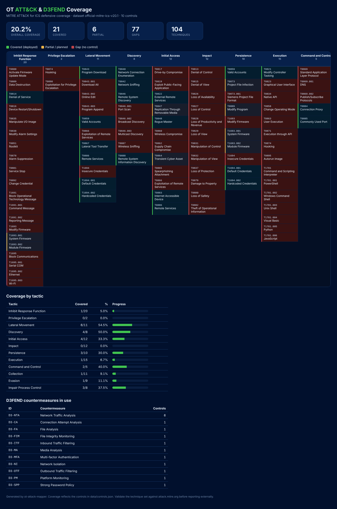

# ot-attack-mapper 🏭🎯

Map your OT/ICS defensive controls to the **MITRE ATT&CK for ICS** matrix and **MITRE D3FEND** countermeasures, then generate a coverage heatmap and a gap-analysis report. Turns "we have some detections" into a defensible, technique-by-technique coverage picture — the kind of artifact IEC 62443 and NIS2/DORA assessments ask for.




## What it does

- Loads the **ATT&CK for ICS matrix** (12 tactics) and your **control inventory**
- Maps each control to the techniques it addresses and the **D3FEND** countermeasure it implements
- Computes coverage **overall and per tactic**, and flags techniques with no control as **gaps**
- Renders an **ATT&CK Navigator-style HTML heatmap** (covered / partial / gap) plus a **Markdown gap-analysis report**
- Can **import the official MITRE STIX bundle** so your technique set stays authoritative

It ships seeded with detections from the companion [modbus-guard](https://github.com/anusshyk/modbus-guard) project and a set of IEC 62443 preventive controls, so it runs out of the box — then you edit `data/controls.json` to match your own environment.

## Why ATT&CK *and* D3FEND

ATT&CK describes what adversaries do; D3FEND describes the defensive countermeasures that address it. Mapping controls to both answers two questions at once: *which attacker techniques can we see or stop?* and *which defensive capabilities are we actually relying on?* That pairing is what makes a coverage report useful for a gap assessment rather than just a wall of green squares.

## Requirements

- Python 3.10 or higher
- No third-party dependencies (standard library only)

## Installation

```bash
git clone https://github.com/anusshyk/ot-attack-mapper.git
cd ot-attack-mapper
```

## Usage

```bash
# Coverage summary (overall + per tactic)
python src/main.py coverage

# List the uncovered techniques (your gaps)
python src/main.py gaps

# Generate the HTML heatmap + Markdown gap report into output/
python src/main.py report -o output/
```

Example summary:

```
ATT&CK for ICS coverage  (dataset official-mitre-ics-v20.1)
  overall: 20.2%  (21 covered, 6 partial, 77 gaps / 104)

  TACTIC                         COVERED       %
  Lateral Movement               6/11     54.5%
  Discovery                      4/8      50.0%
  Impact                         0/12      0.0%
  ...
```

## Defining your controls

`data/controls.json` is the file you own. Each entry maps a control to the techniques it covers and the D3FEND countermeasure it implements:

```json
{
  "id": "DET-MG-002",
  "name": "modbus-guard: unauthorized write command detection",
  "type": "detection",
  "status": "deployed",
  "covers": ["T0836", "T0855", "T0821"],
  "d3fend": [{"id": "D3-NTA", "name": "Network Traffic Analysis"}]
}
```

`status` is `deployed` (counts as covered), `partial`, or `planned`.

## Keeping the technique set authoritative

The bundled `data/attack_ics.json` is generated directly from the **official MITRE ATT&CK for ICS STIX bundle (v20.1)** — 12 tactics and 104 current techniques and sub-techniques. To refresh it when MITRE publishes a new version:

```bash
# Get the latest bundle from:
#   https://github.com/mitre-attack/attack-stix-data (ics-attack/ics-attack-<version>.json)
python src/main.py import-stix ics-attack-20.1.json -o data/attack_ics.json
```

The importer keeps only current (non-deprecated, non-revoked) techniques and preserves tactic mappings. The seed controls in `data/controls.json` reference current technique IDs (e.g. credentials map to `T1694.001`/`T1694.002`, firmware to `T1693.001`/`T1693.002`).

## Project structure

```
ot-attack-mapper/
├── src/
│   ├── main.py        # CLI: coverage, gaps, report, import-stix
│   ├── coverage.py    # Coverage engine (controls -> techniques -> gaps)
│   └── report.py      # HTML heatmap + Markdown gap report
├── data/
│   ├── attack_ics.json  # ATT&CK for ICS matrix (official MITRE v20.1)
│   └── controls.json    # Your control inventory (edit this)
├── docs/
│   └── heatmap.png      # Rendered example
├── tests/
│   └── test_coverage.py # 14 tests incl. dataset-integrity checks
├── requirements.txt
├── LICENSE
└── README.md
```

## Running the tests

```bash
python -m unittest discover -s tests -v
```

The suite includes dataset-integrity tests: technique IDs are unique and well-formed, every technique maps to a valid tactic, and per-tactic counts match the official matrix.

## Notes & limitations

- The bundled matrix is MITRE ATT&CK for ICS v20.1 — re-run `import-stix` when MITRE ships a newer version.
- Control-to-technique and control-to-D3FEND mappings are judgement calls; review them with your team.
- Coverage is a planning aid, not an assurance of detection efficacy. A "covered" technique still needs its detection tuned and tested.

## License

MIT License — see [LICENSE](LICENSE).

---

Built by [Muhammad Anas Shaikh](https://github.com/anusshyk) — Cybersecurity & IT Infrastructure Specialist, aligning OT detection and GRC with MITRE ATT&CK for ICS, D3FEND and IEC 62443.
